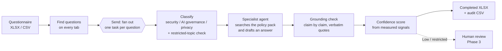

# AI Security Questionnaire Responder

**LangGraph + Claude agents that draft grounded answers to security and AI due-diligence questionnaires, and know when to hand a question to a human.**

B2B SaaS vendors receive long questionnaires from prospects ("Do you encrypt data at rest?", "Do you train AI on our data?", "How are you classified under the EU AI Act?"). Answering them means digging through internal policies, and a wrong answer can become a contractual promise. This project drafts every answer from the vendor's own documentation, cites the exact policy clause behind it, and scores its confidence from measured evidence rather than the model's self-assessment. Anything it can't back up goes to a human.

> Everything here is fictional: the vendor (**Acme SaaS**), its policy pack and the prospect (**Globex Holdings plc**).

## Status

| Phase | What | Status |
|---|---|---|
| 1 | Policy pack, FTS5 retrieval, one question end to end with citations + confidence | ✅ Done |
| 2 | Whole questionnaire in parallel (LangGraph `Send`), messy XLSX/CSV in, completed XLSX + audit trail out | ✅ Done, first real run below |
| 3 | Human review with `interrupt()` + checkpointer, approved-answer library (learning loop) | Planned |
| 4 | Streamlit UI, full evals, calibrated thresholds | Planned |

## How it works

1. **Ingest.** It finds the question table on each tab, wherever the header row is. It works out which columns hold the ref, question, answer and evidence, and skips covers, section rows, footers and reviewer-only columns. Sub-questions like `a) …` get their parent row's context.
2. **Classify.** A small Claude model routes each question to a specialist. Restricted topics (guarantees, contractual commitments, liability, SLA credits, confidential reports) are flagged by **both** a keyword rule and the classifier.
3. **Specialist agent.** Claude Opus has a `search_policies` tool over a SQLite FTS5 index of the policy pack. It runs its own keyword searches, then drafts a 1–3 sentence answer from the retrieved sections only. All specialists search the whole pack, because answers often sit in another team's document; what differs is their instructions.
4. **Grounding check.** A second pass splits the answer into claims. For each one it names the supporting section, copies a verbatim quote and gives a verdict: explicit, inferred or unsupported. **The code then checks the quote really appears in the cited section** and downgrades the claim if it doesn't.
5. **Confidence.** The level comes from measured signals, not the model's opinion:

| Level | Rule (thresholds calibrated with evals) | Action |
|---|---|---|
| 🟢 High | Every claim supported **and** quoted verbatim, strong search match | Auto-approve |
| 🟡 Medium | ≥ 75% of claims supported, some inferred | Human review |
| 🔴 Low | Weak support, **or** restricted topic | Human review |
| 🔴 Escalate | Policy pack doesn't cover it → `Not covered by policy, escalate` | Human writes the answer |

## Data

| Path | What |
|---|---|
| `data/policies/` | Acme's policy pack: 10 short docs (InfoSec, AI governance, model card, retention, sub-processors, incident response, hosting, SSO/SCIM, privacy, BCP). Every section has a citable ID like `AIG-3`. **Gaps are deliberate.** |
| `data/questionnaires/` | Globex's 60-question due-diligence questionnaire. Three tabs with three different layouts, merged headers, sub-questions, blank rows, a hidden column, dropdowns, an off-topic question and a duplicate. The AI tab maps questions to NIST AI RMF, ISO/IEC 42001 and the EU AI Act. |
| `data/evals/golden_set.csv` | Answer key: expected specialist, outcome and source sections for every question (41 high, 6 medium, 2 partial, 5 restricted, 6 gap). |
| `data/evals/policy_coverage.md` | What the pack covers explicitly, only implies, restricts or deliberately leaves out. |
| `scripts/build_sample_questionnaire.py` | Regenerates the questionnaire and answer key. |

## Results: first full run (run 1)

All 60 Globex questions, Claude Opus 5.5 specialists and grounding, Claude Haiku 5.5 classifier. Full trail in [`results/run1_audit.csv`](results/run1_audit.csv).

| Check | Result |
|---|---|
| Trap questions escalated (PCI DSS, bug bounty, cyber insurance, escrow, model version, ESG) | **6 / 6** |
| Restricted questions kept from auto-approve (guarantees, indemnity, liability, full pen-test report, 24h commitment) | **5 / 5** |
| Implied / partial questions sent to a human | **8 / 8** |
| Routed to the expected specialist | **100%** |
| Cited the expected policy section | **100%** |
| Clearly answerable questions auto-approved | 27 / 41 |
| Claims checked | 251 (223 explicit, 21 inferred, 7 unsupported) |

**No unsafe outcomes.** No trap or restricted question was auto-approved. Every miss was over-caution: answerable questions sent to review. The audit trail showed three causes:

1. **The classifier over-flagged commitments.** It treated "what is your breach-notification timeframe?" as a request for a new promise. The keyword rule already catches real commitment requests, so the classifier definition can be stricter.
2. **The answers over-answered.** Drafts added related facts nobody asked for, and each extra claim is another chance to be marked inferred.
3. **The grounding check was too literal.** It marked a bare "Yes." or a faithful rewording as inferred.

It also caught a genuine gap the answer key had missed. *"Is our data used to improve your products or train AI?"*: the policy rules out AI training but says nothing about product improvement. The answer key has been corrected.

**Next run:** tighter classifier definition, "answer only what was asked" drafting, and meaning-based (not wording-based) grounding verdicts, with the verbatim-quote check kept in code.

## Quick start (Google Colab)

1. Open `notebooks/demo.ipynb` in Colab.
2. Add `ANTHROPIC_API_KEY` in Colab Secrets.
3. Zip the `data/` folder and upload it when section 2 asks.
4. Sections 1–12 answer single questions. Sections 13–18 upload a questionnaire, answer it in parallel, download the completed XLSX and audit CSV, and score the run against the answer key.

A full 60-question run makes about 300 model calls.

## Stack

LangGraph (state graph, `Send` fan-out) · langchain-anthropic · Claude Opus 5.5 (specialists, grounding) · Claude Haiku 5.5 (routing) · SQLite FTS5 with BM25 ranking and Porter stemming · openpyxl · pandas

## Roadmap

- **Phase 3:** `interrupt()` + checkpointer for approve / edit / reject on Medium, Low and restricted answers; an approved-answer library checked first; a separate reviewer note so caveats never leak into customer-facing text; auto-fill for Yes/No dropdown columns.
- **Phase 4:** package the code into `src/responder/`, a Streamlit review UI, an eval runner (routing, citation coverage, LLM-judge faithfulness, auto-answer rate, escalation correctness, calibration of High), and thresholds calibrated against the golden set.
