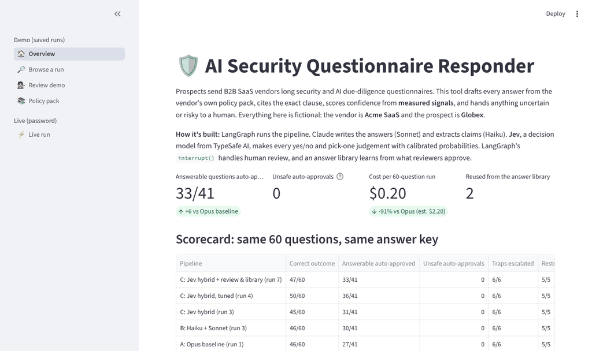
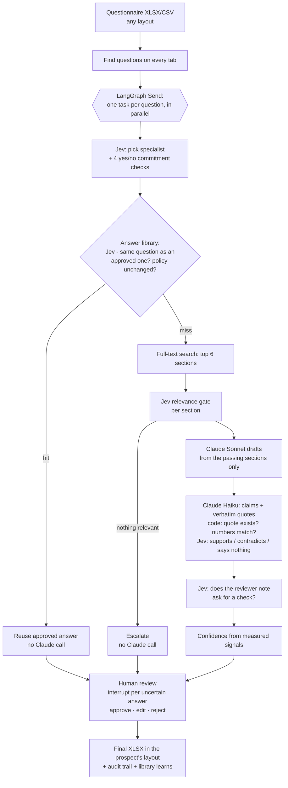

# AI Security Questionnaire Responder

[](https://github.com/jrzajko/ai-questionnaire-responder/actions/workflows/tests.yml)

**Grounded answers to security and AI due-diligence questionnaires, built with LangGraph, Claude and Jev, with a human in the loop.**

Prospects send B2B SaaS vendors long questionnaires: *"Do you encrypt data at rest?"*, *"Do you train AI on our data?"*, *"How are you classified under the EU AI Act?"* Answering them means digging through internal policies, and a wrong answer can become a contractual promise.

This tool:
- drafts every answer from the vendor's own policy pack;
- cites the exact clause behind it;
- scores confidence from **measured evidence**, never the model's opinion of itself;
- routes anything uncertain, risky or uncovered to a person;
- learns from what that person approves.

**Live demo:** *Streamlit link added after deployment.* · Everything is fictional: the vendor is **Acme SaaS** and the prospect is **Globex Holdings**.



## Results

The same 60-question Globex questionnaire was run through every pipeline and scored against the same answer key ([`data/evals/golden_set.csv`](data/evals/golden_set.csv)).

| Pipeline | Answerable auto-approved | **Unsafe auto-approvals** | Traps escalated | Restricted held | Cost per run |
|---|---|---|---|---|---|
| A: Opus does everything (baseline) | 27 / 41 | **0** | 6 / 6 | 5 / 5 | ≈ $2.20 (est.) |
| B: Haiku + Sonnet | 30 / 41 | **0** | 6 / 6 | 5 / 5 | $0.34 |
| C: Jev hybrid | 31 / 41 | **0** | 6 / 6 | 5 / 5 | $0.16 |
| C: Jev hybrid, tuned | **36 / 41** | **0** | 6 / 6 | 5 / 5 | $0.17 |
| **C + human review + answer library** (final) | 33 / 41 | **0** | 6 / 6 | 5 / 5 | **$0.20** |

- An answer is **unsafe** if it was auto-approved although the answer key says a person must see it: a trap, a commitment, a partial answer. That number has been **0 in every run**.
- The final pipeline auto-approves 6 more answers than the Opus baseline, at **about 9% of the cost**.
- It sits 3 below the tuned run, mostly for a deliberate reason: it now holds back answers whose reviewer note asks for a check, e.g. *"confirm the certificate is still valid before sending."*
- Costs are measured from the APIs' own token counts, except the baseline's, which was estimated before cost tracking existed.

**Held-out check:** the thresholds were tuned on those 60 questions, so 26 fresh questions ([`heldout_set.csv`](data/evals/heldout_set.csv)) were written and **committed before any run**, to test whether they generalise. *Results pending: run [`notebooks/evals.ipynb`](notebooks/evals.ipynb).*

The run-by-run story, including what went wrong and how it was fixed, is in [`docs/results_log.md`](docs/results_log.md).

## How it works



**Each part does what it's best at:**

| Job | Done by | Why |
|---|---|---|
| Writing customer-facing answers | **Claude Sonnet** | The only step that needs a capable writer |
| Splitting answers into claims, copying quotes | **Claude Haiku** | Extraction: cheap and fast |
| Every yes/no and pick-one judgement | **[Jev](https://docs.typesafe.ai)** (TypeSafe AI) | A *decision model*: returns calibrated probabilities instead of text, at about 1/100th of Opus's input price |
| Arithmetic, numbers, verbatim matching | **Code** | Jev's docs say plainly that it isn't a calculator |
| Contractual commitments, gaps, judgement calls | **A person** | Through LangGraph `interrupt()`, with every decision logged |

**Confidence is measured, not self-reported.** An answer is **High** only if all of these hold:
- every claim is supported by a cited section;
- every quote appears **verbatim** in that section, and every number matches;
- Jev says the section supports it, with confidence ≥ 0.8;
- the question isn't a commitment;
- the sections answer every part of the question;
- the reviewer note doesn't ask for a check.

Anything else goes to a person, most important first. Every probability is logged, so thresholds can be re-tuned against the answer key **without new API calls**.

**Human review and learning:**
- The questionnaire graph runs on a **SQLite checkpointer**. A reviewer can stop half-way and resume later, and nothing is answered or paid for twice.
- Approved and edited answers enter the **answer library** together with the policy section versions they rest on. A later question that asks for the same information reuses the approved answer.
- Two exceptions: commitments always go back to a person, and an answer whose policy section has since changed version is never reused.

## What the experiments showed

1. **Cheap models were as safe as Opus.** Across all 60 questions, swapping Opus for Haiku + Sonnet or for the Jev hybrid kept every safety check. The real problem was over-caution: answerable questions sent to review.
2. **Probabilities make a system tunable.** Pipeline B's misses came from Haiku's word-based verdicts, which only a prompt rewrite and a paid re-run can change. Pipeline C's came from thresholds on saved probabilities. Re-scoring the run offline predicted **50/60 correct and 36/41 auto-approved**, and the next real run matched exactly.
3. **Decision models read literally.** Jev judged *"Globex is the data controller"* to contradict *"the customer is the data controller"*. Writing answers about "the customer" fixed that, and also made them reusable across prospects.
4. **Every safety layer has a precision cost.** The reviewer-note check first held back 7 answerable questions. The notes Jev scored highest (0.71–0.95) were the useful ones, and those that stayed auto-approved scored 0.10–0.39. So the hold line moved from 0.4 to 0.7, and the drafting prompt was tightened. The next run recovered 4 auto-approvals.
5. **Separation beats cleverness.** Restricted questions scored 0.83–0.96 on Jev's commitment checks, and every other question 0.38 or less, apart from one borderline wording at 0.62. The keyword rule still backs Jev up.

## Try it

**Streamlit app** (`app/streamlit_app.py`):
- **Demo mode** is free: explore the saved runs, the scorecard, claim checks and Jev's gate, a review queue, and the policy pack.
- **Live mode** is password-protected: upload a questionnaire, answer it with Claude and Jev, review it, and download the completed XLSX, the audit trail and the library.

**Google Colab notebooks:**

| Notebook | What it shows |
|---|---|
| [`review_and_library.ipynb`](notebooks/review_and_library.ipynb) | The full workflow: answer, review with pause and resume, library reuse |
| [`evals.ipynb`](notebooks/evals.ipynb) | Scorecard on the held-out questions, with an LLM judge for faithfulness |
| [`cost_comparison.ipynb`](notebooks/cost_comparison.ipynb) | The A/B/C experiment, with measured costs |
| [`demo.ipynb`](notebooks/demo.ipynb) | Phases 1–2: the original Opus pipeline, step by step |

**Locally:**
```bash
pip install -e ".[app,dev]"
pytest                                    # offline tests with stand-in models: no API keys needed
export ANTHROPIC_API_KEY=... TYPESAFE_API_KEY=...
python evals/run_evals.py --set heldout   # about $0.20
streamlit run app/streamlit_app.py
```

**Deploying the app on Streamlit Community Cloud:**
1. Choose *New app*, then this repo, branch `main`, file `app/streamlit_app.py`.
2. Under *Advanced settings → Secrets*, add:
   ```toml
   ANTHROPIC_API_KEY = "..."
   TYPESAFE_API_KEY = "..."
   APP_PASSWORD = "..."
   ```

Demo mode works without any secrets.

## Repository

```
src/responder/        the package
  config.py           models, prices, thresholds (tuned values as defaults)
  retrieval.py        policy pack → labelled sections → SQLite FTS5 (BM25)
  agents.py           Claude + Jev clients, prompts, Jev questions, cost tracking, rule checks
  graph.py            per-question graph, questionnaire graph with interrupt() review, dropdown fill
  library.py          answer library with stale-policy detection
  io.py               messy XLSX/CSV in, completed XLSX + audit trail out
  evals.py            eval metrics, LLM judge, scorecards
  state.py            graph state and structured-output schemas
app/streamlit_app.py  demo + live front end
evals/run_evals.py    command-line eval runner
tests/                offline tests with stand-in Claude and Jev (run in CI)
data/policies/        Acme SaaS policy pack: 10 docs, 67 citable sections, deliberate gaps
data/questionnaires/  Globex's 60-question questionnaire: 3 differently laid-out tabs
data/evals/           answer keys: golden_set.csv (60), heldout_set.csv (26), coverage map
results/              audit trail and measured cost of every run
docs/                 results log, demo GIF
notebooks/            Colab notebooks (self-contained, kept as the record of each phase)
```

## Limitations

- **One policy pack, one questionnaire family.** The held-out set tests generalisation within Acme's policies, not to another company's documents.
- **Thresholds were tuned on 60 questions.** The held-out run checks them, but real calibration needs far more volume.
- **Implied-only questions are escalated rather than drafted.** It's safe, but the reviewer starts from a blank answer.
- **Two-part questions** can fall just under the relevance line when each section answers only half.
- **The stale-policy check is tested offline only.** It needs a real policy change to see live.
- **The early notebooks duplicate code.** The package is now the source of truth, and the notebooks are kept as a record of each phase.

## Stack

LangGraph (`Send` fan-out, `interrupt()`, SQLite checkpointer) · Claude Sonnet 5.5 and Haiku 5.5 via langchain-anthropic · Jev (TypeSafe AI) via `typesafe-sdk` · SQLite FTS5 · openpyxl · pandas · Streamlit · pytest + GitHub Actions
